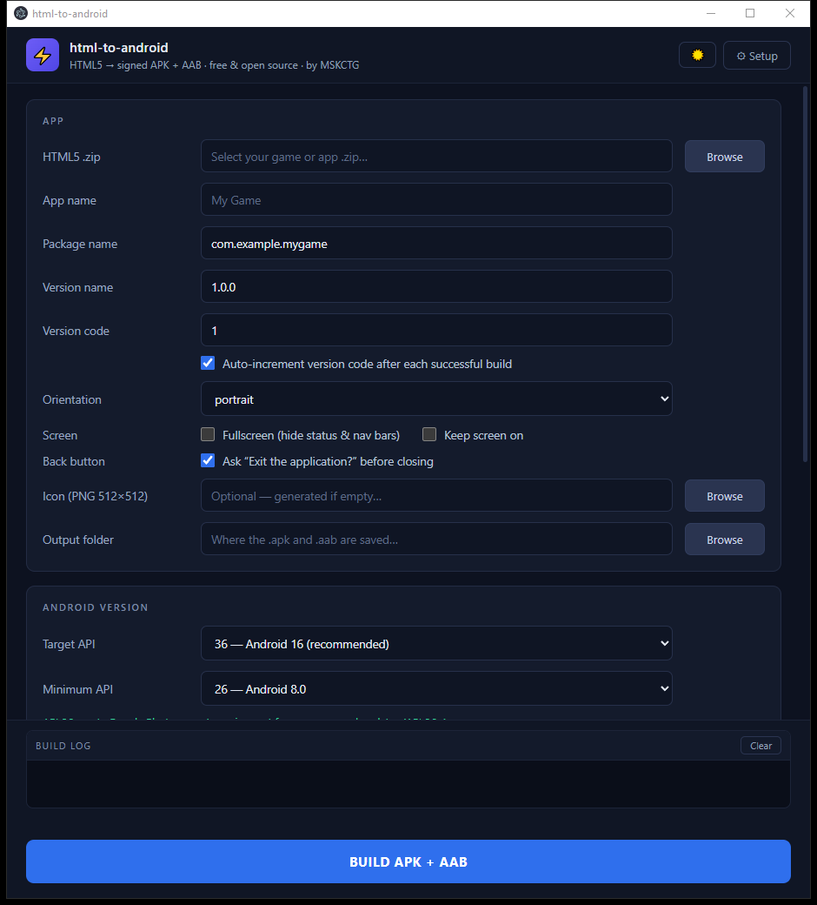

# html-to-android

**Turn any HTML5 game or app (`.zip`) into a signed Android APK + AAB — free, open source, Windows.**

`HTML5 → signed APK + AAB · free & open source · by MSKCTG`

[](https://github.com/sajjad-ctg/html-to-android/actions/workflows/ci.yml)



## Why

You built an HTML5 game — now you want it on Android: on the Play Store, or just as an APK friends can install. Normally that means learning Android Studio, Gradle, Java and keystore signing.

This app puts all of that behind one dark-themed window: pick your zip, choose a few options, press **BUILD APK + AAB**.

## Features

- **APK + AAB in one build** — APK for sideloading/testing, AAB for Google Play upload
- **Always signed** — works out of the box with a bundled default test key; switch to your own keystore when publishing (Play Store requires it)
- **No Android Studio, no admin rights** — first run downloads JDK + Android SDK + Gradle (~1.7 GB) into `%LOCALAPPDATA%\html-to-android` only, and reuses them forever; builds work **offline** afterwards
- **Immersive fullscreen** — hides status + navigation bars; a swipe from any edge briefly reveals them (standard game behavior)
- **Back-button confirm** — goes back in page history when possible, otherwise shows a native *"Exit the application?"* **[Cancel] [Exit]** dialog instead of instantly quitting
- **Keep screen on** — the screen never sleeps mid-game
- **Orientation lock** — portrait / landscape / any
- **Export bridge** — injects `window.AndroidBridge.saveFile(name, mime, base64)` so HTML5 apps can export JSON/CSV/PDF straight to the phone's **Downloads** folder (WebView ignores plain `<a download>` links — this fixes that)
- **Version auto-increment** — tracked **per package name**, so every build of the same app gets `versionCode + 1` (Play requires this)
- **App icon** — drop in a 512×512 PNG, resized to every density automatically
- **Advanced overrides** — Compile API / AGP / Gradle versions, default `auto`
- **Light / dark theme toggle**

## Requirements

- Windows 10 or 11 (64-bit)
- Internet for the **first run only** (one-time toolchain download, ~1.7 GB)
- Your HTML5 project as a `.zip` containing `index.html`
- For Google Play: your own keystore (create one in the app) + a Play Console account

## Quick start

### Option A — installer

1. Download `html-to-android Setup 0.1.0.exe` from **Releases**
2. Run it — if Windows SmartScreen warns, click **More info → Run anyway** (the installer is not code-signed yet)
3. On first launch press **Setup** and wait for the toolchain download

### Option B — from source

```bash
git clone https://github.com/sajjad-ctg/html-to-android.git
cd html-to-android
npm install
npm start
```

## How to build an app

1. **APP** — browse to your `.zip`, set the app name and package name (`com.yourname.game`), version name
2. **ANDROID VERSION** — target API (default **36** — the current Play Store requirement), orientation, and the Screen/Back-button checkboxes
3. **SIGNING** — leave unchecked for quick tests (default test key is used automatically); tick it + pick a keystore when building for the Play Store
4. Press **BUILD APK + AAB** — first build ≈ 2 min, later builds faster
5. Your APK + AAB appear in the chosen output folder

## Good to know

- **Play Store policy** — since **Aug 31, 2026**, Google requires *target API 36* for new apps and updates. This app defaults to exactly that; the Advanced section is there for future bumps.
- **Test key vs your keystore** — unticked = signed with the bundled test key: perfect for sideloading, but **Play rejects it**. Ticked = signed with your keystore, which Play requires. Important: once an app is published, its updates must keep the **same** keystore forever.
- **Where files live** — `%LOCALAPPDATA%\html-to-android`:
  - `toolchain` + `gradle-home` — one-time download, reused for every build (don't delete)
  - `test-keys`, `state` — your default test key + version history per package
  - `work` — build scratch space, **cleaned automatically after every successful build** (kept after failures for debugging)
- **Offline** — after the first Setup, no internet is needed to build.

## Building the installer yourself

```bash
npm run dist   # → dist/html-to-android Setup 0.1.0.exe  (+ portable exe)
```

## Status / roadmap

**v0.1.0** — all core phases complete: UI → toolchain downloader → project generator → Gradle build → signing → packaging + CI. Verified end-to-end with a real HTML5 game.

## Contributing

Issues and pull requests are welcome once the repository goes public.

## License

[MIT](LICENSE) © 2026 MSKCTG.
Bundled components (Capacitor, Gradle wrapper — Apache-2.0; Electron, jimp — MIT) are listed in [THIRD-PARTY-NOTICES](THIRD-PARTY-NOTICES).

— by **MSKCTG**
